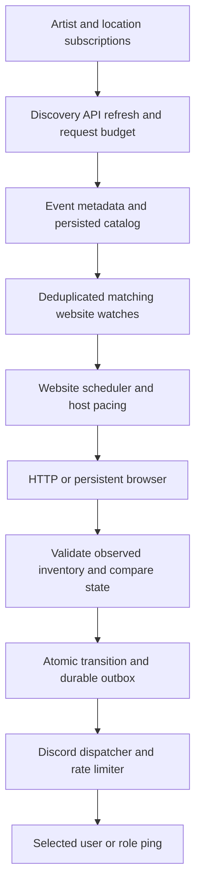

# Ticket: artist and location monitoring architecture

Design date: 2026-11-09. Status: long-term design. The first Rust implementation now exists; see [running the monitor](running.md) for implemented features and limits. Live inventory access and end-to-end latency remain unverified.

Current acquisition decision: **combine the Discovery API with website monitoring**. Discovery finds events for chosen artists and locations and supplies catalog metadata. Website adapters check selected event pages for observable availability and offer details. The user has an API Explorer V2.0 key, but restricted inventory API access is not established. See [running the monitor](running.md) for implemented subscriptions, generated watchlists, budgets, and background refresh. See [website monitoring](website-monitoring.md) for live-access evidence. Optional inventory API batching below remains a future extension.

## 1. Goal and scope

The user chooses **which artist/performer to monitor and where their events should be**. Monitor only matching events and send Discord bot pings as soon as the available data supports an alert. Support location selection worldwide, subject to source coverage.

Optimize time from a matching availability change to Discord accepting the alert. Also measure new-event discovery separately. A newly listed show and a restock for a known show have different detection paths.

Default interpretation of availability: an event has primary tickets reported available. Resale is separately selectable. Event-level inventory does not establish that a particular quantity, adjacent seats, price, or presale eligibility is available. Those filters require a suitable additional authorized source.

The user's subsequent screenshots clarify the desired output: section/offer-level Discord alerts with prices and quantities, as described in the [alert reference](alert-reference.md). Event-level status remains a limited fallback, explicitly labeled; it does not fulfill detailed inventory monitoring. The source adapter must declare which fields it can actually observe.

## 2. Language and runtime choice

**Choose Rust.** It compiles to native code, avoids garbage-collection pauses, and supports efficient asynchronous networking. C++ is also a credible native-performance choice; there is no defensible universal winner without benchmarking the actual workload. Go could be competitive here because most time is spent waiting for external systems.

Use Tokio for asynchronous tasks, a reused reqwest client with rustls for HTTP, serde for typed parsing, rusqlite on a dedicated database thread for SQLite, and Discord REST delivery through a reused reqwest client. Cargo.lock pins the implementation dependencies. Start with standard libraries and safe Rust; add specialized parsing or allocator tuning only if profiling demonstrates a useful latency reduction. [Rust performance characteristics](https://rust-lang.org/).

Run one always-on Linux service with restart supervision and a persistent SSD volume. Keep discovery, polling, persistence, and Discord delivery in separate bounded tasks inside the same process. This avoids cold starts and unnecessary service hops. The website adapter uses direct HTTP when sufficient and a separate persistent Chromium worker when rendering is required. Optional API adapters do not need a browser.

## 3. User experience

Artist/location subscriptions currently use TOML and CLI commands. Discord slash commands below remain proposed:

| Command | Behavior |
| --- | --- |
| `/monitor add` | Choose artist, location filters, primary/resale, and alert destination. |
| `/monitor list` | Show subscriptions, matched events, effective check intervals, and coverage. |
| `/monitor events` | Show matching shows; allow excluding individual events. |
| `/monitor pause` / `/monitor remove` | Pause or remove a selected subscription. |
| `/monitor status` | Show last successful checks, source health, quota headroom, and Discord backlog. |

Artist search returns candidates for selection and stores Ticketmaster attraction IDs, not just name substrings. Handle similarly named artists explicitly. Model an artist as a set of verified source IDs if markets use different records; do not assume one ID covers every market.

Locations can be any supported country, a list of countries, a city/radius, or selected venues. Resolve ambiguous cities using country and coordinates; prefer venue IDs where possible. Match **artist AND location**, with OR within each selected artist/location list. Example: the selected artist in London or Manchester. Store event timezones separately from the user's display timezone.

Each subscription has a persisted version. Pausing, removing, or changing it invalidates its outstanding timers and pending delivery contributions. Before dispatch, recheck active versions and recompute merged mention targets; cancel a delivery when no active subscription remains. A message already accepted by Discord cannot be retroactively un-pinged.

The bot replies with the resolved selection, matching shows, inventory coverage, and expected cadence. A user may choose all locations for an artist. Overlapping watches share event checks and deduplicate alerts per recipient/destination.

Initial setup summarizes already-available events once; it does not present them as newly released tickets. Future new matching events generate a distinct “new event found” alert. The default inventory alert is the first positive observation after unavailability; recovery from unknown status is labeled accurately.

## 4. Data sources and capability checks

These observations come from official documentation reviewed on the design date. Reconfirm the account's capabilities before enabling live monitoring.

| Source | Verified characteristic | Design use |
| --- | --- | --- |
| [Discovery API](https://developer.ticketmaster.com/products-and-docs/apis/discovery-api/v2/) | Artist/location search, sale dates, event status; documentation lists 5,000 requests/day and 5 requests/second. | Find selected artists' shows and sale schedules. Do not treat an `onsale` event status as inventory proof. |
| [Developer FAQ](https://developer.ticketmaster.com/support/faq/) | Lists 2 requests/second and 5,000/day, conflicting with the API page. Describes hourly feed refreshes. | Use conservative Discovery defaults until account limits are verified. |
| [Inventory Status API](https://developer.ticketmaster.com/products-and-docs/apis/inventory-status/) | Authorized access; near-real-time event statuses; batches must share source and region, within 7KB (approximately 350 IDs). Price refreshes are at most hourly. | Preferred inventory signal. Validate market coverage, HTTP method, account quota, response shape, and freshness. |
| [Partner Availability API](https://developer.ticketmaster.com/products-and-docs/apis/partner/availability/) | Restricted access; inventory may be cached for extended periods, and the endpoint is labeled “Polling: No.” | Do not assume this is a fast polling substitute. |
| [Discovery Feed](https://developer.ticketmaster.com/products-and-docs/apis/discovery-feed/) | Country-level bulk catalog files. Its public-access description differs from the FAQ's approved-partner wording. | Optional later optimization for many overlapping artist searches; confirm account access first. |

Keep an explicit capability matrix by source, country, and account. Distinguish supported inventory, metadata-only coverage, temporarily unavailable status, and unsupported markets. A country being discoverable does not imply inventory coverage there. Report uncovered selections instead of silently dropping them.

There is no verified Ticketmaster inventory push feed available to this project. Add a push adapter only if the account is actually offered one with documented semantics. Do not design around assumed webhooks.

With a Discovery key, use artist/event searches, subscriptions, and background catalog refresh. Sale schedules are metadata; scheduled-sale reminders remain planned. Inventory monitoring remains unavailable until a suitable API or website source is validated and configured. Website responses require their own signal semantics and access constraints; do not apply Inventory Status batching or API quotas to page fetching.

## 5. Data flow



Discovery and metadata refresh run independently of inventory polling. A matching event enters the active set immediately after discovery. Reuse stored metadata when creating an alert; do not request artist images or event descriptions before dispatch.

The implemented hybrid path uses attraction IDs and location filters to discover matching events, validates event identity and profile host coverage, and saves generated website watches. Manual watches take precedence for overlapping canonical URLs (including explicit pauses); otherwise the first configured subscription wins. Partial scans retain cached matches and resume saved pagination, while complete scans can retire unmatched watches without inventing negative inventory observations. It refreshes the catalog separately from website checks; the default is 15 minutes with bounded pagination and a persisted rolling request budget. Discovery status and advertised price ranges remain metadata and never create stock observations. The website-monitoring document defines page classification and access handling. Website artist-link discovery remains a manual alternative. Large queries can exceed paging or configured limits; the implementation reports incomplete coverage rather than assuming every result was found. Automatic date-range partitioning and sale-window discovery priorities remain future work.

New-event detection is bounded by upstream catalog freshness plus the discovery interval. Faster inventory polling cannot discover an event that has not entered the catalog. Bulk feeds, if later adopted, reduce search work but do not imply immediate discovery.

Store canonical `(source, country, universal_event_id)` mappings; keep legacy IDs separate. Maintain indexes from event to subscriptions and from recipient to delivery preferences. One upstream observation can satisfy multiple subscriptions.

## 6. Fast polling process

The primary website process is specified in [website monitoring](website-monitoring.md). Shared principles are persistent clients, bounded concurrency, due-time scheduling, durable transitions, and prompt Discord dispatch. The following batch/credential-budget procedure applies specifically to an optional inventory API adapter; do not transfer its batching or rate assumptions to scraping.

1. Build due batches from the selected event set, grouped by source, region, and priority. Enforce encoded request-byte limits, rather than assuming every 350 IDs fit. Dispatch due priority events without waiting to fill a batch.
2. Obtain permits from the quota controller for the actual credential/endpoint budget. All watches, retries, and background work sharing that budget participate. Inventory limits are separately configured; Discovery limits do not establish Inventory Status limits.
3. Issue bounded asynchronous requests through an existing connection pool. Negotiate HTTP/2 where supported; retain HTTP/1.1 keep-alive otherwise. Use TLS verification, DNS refresh, connection reuse, and deadlines based on measured response times.
4. Validate each response and event identity, then parse only required fields. Missing IDs in a partial batch become unknown observations. Bound response size and decompression work. Keep one in-flight observation per event and reject late responses from obsolete request/watch generations.
5. Compare with in-memory state. On a qualifying positive transition, persist the transition and notification together; immediately wake the Discord dispatcher after commit. No second confirmation poll is required for an authoritative positive status.
6. Schedule the next absolute monotonic deadline. Skip missed slots instead of firing catch-up bursts. Every attempted request counts conservatively against its applicable budget, including failures with uncertain server accounting.

Use two initial priorities: active sale/restock watches receive the shortest feasible interval; other selected events receive a lower guaranteed share. A configurable sale window, initially two minutes before to fifteen minutes after a scheduled opening, raises priority. Restock watches can stay high priority outside sale windows. These values are tuning proposals, not source guarantees.

The rate controller enforces short-window limits, daily allowance, maximum concurrency, and reserved capacity for retries/discovery where budgets overlap. Persist allowance/reset accounting across restarts and reconcile with authoritative headers when available. Reduce frequency before exhausting the allowance. Show the resulting cadence to the user; never display an infeasible requested interval as the actual interval.

Reserve small blocks of daily request permits durably before spending them, and replenish asynchronously ahead of exhaustion. After a crash, conservatively discard unused permits from a reserved block until the quota resets. This bounds accounting error without a disk write on every poll. A separate paced limiter enforces short-window limits; block reservations never authorize a burst. Persist known cooldowns and reset information. On restart, restore cooldowns and wait out the configured short-window interval before resuming if recent request timing is uncertain.

Respect `Retry-After` and the affected quota scope on 429 responses. Use bounded exponential backoff with jitter for transient failures; isolate unhealthy sources. Invalid credentials pause their adapter. Quota exhaustion and unsupported markets remain visible. Unknown quota configuration leaves inventory polling disabled until verified.

## 7. Speed and capacity model

End-to-end latency is:

```text
source publication/cache delay
  + wait until next successful poll
  + Ticketmaster request/response time
  + local parsing, state transition, and durable commit
  + Discord queue wait and request/response time
  + Discord/device notification delay
```

For a fixed successful polling interval Δ and uniformly timed changes, the average sampling delay is Δ/2 and p95 is approximately 0.95Δ. This is not an end-to-end guarantee. Errors, changing intervals, caches, and short-lived inventory violate the simple assumptions; an availability window shorter than the interval can be missed entirely.

For equally prioritized events, define K as the requests required for one complete sweep **after** source/country/byte partitioning. If r is the request rate available to these checks, Q their daily allowance, and C the concurrency limit:

```text
ideal sweep interval Δ >= max(K / r, 86,400 × K / Q)
concurrency adds an approximate constraint: Δ >= K × mean_request_time / C
```

Use the actual budget remaining over the reset horizon in the scheduler. The day formula is a steady-state planning estimate. Subtract headroom for retries and shared operations first. Optimize the actual tail, not only the mean-request concurrency estimate.

Illustrative selected-event scenarios, assuming IDs fit and the account authorizes the traffic:

| Selected events | Request groups | Target interval | Minimum requests/second | Requests/day |
| --- | --- | --- | --- | --- |
| 20 in one source/country | 1 | 1 second | 1 | 86,400 |
| 100 across five source/country groups | 5 | 1 second | 5 | 432,000 |
| Same 100 events | 5 | 5 seconds | 1 | 86,400 |

These are capacity calculations, not actual account entitlements or promises. A one-second sampling interval costs substantial quota even with very few events. Shared batches reduce cost; adding machines does not create quota. Selecting artists and locations reduces the active set and makes fast monitoring more attainable.

Initial engineering targets, to be tested rather than advertised: p99 under 5 ms for parsing/state evaluation, and p99 under 20 ms from a complete valid response to a committed, dispatchable alert on the chosen host under expected load. External latency is excluded. Set any end-to-end target only after measuring the real account, endpoint, deployment region, and Discord destination.

## 8. Availability semantics and durability

Keep inventory state, last valid evidence, observation health, and sale schedule as separate fields. Track primary and resale independently. Treat positive availability and limited availability as positive states; unknown values are not negative evidence.

The following table describes event-level changes. For a source exposing offers, track changes per stable offer key as well: new matching offers, quantity thresholds, and price-filter crossings can trigger alerts while the overall event remains available. Do not infer that an omitted offer is gone unless the response is a validated complete snapshot. See the alert reference for identity, quantity semantics, and deduplication rules.

| Observation | State and notification behavior |
| --- | --- |
| Valid unavailable → positive | Increment transition generation and enqueue one availability alert per destination. |
| Positive → positive | Update evidence; do not ping on every poll. |
| Valid unavailable after positive | Persist the negative transition so a later restock can alert. |
| Timeout, throttling, stale evidence, missing event, or parse error | Mark health unknown; preserve last valid inventory state. Do not manufacture a restock. |
| First positive without prior negative | Label “availability observed,” or include in initial setup summary. |
| Scheduled sale timer fires | Send a separately labeled schedule reminder; do not change inventory state. |

Where upstream timestamps or cache metadata exist, retain them and assess age. Otherwise record local receipt time and explicitly treat source age as unknown; a fast response does not establish fresh data. Timers use UTC source dates and a monotonic clock; recompute future deadlines after clock or schedule changes. Unknown/TBD dates cannot trigger exact sale reminders.

Use SQLite WAL with durable synchronous commits on persistent local storage. A dedicated database thread executes transactions so disk work does not block Tokio workers. Persist subscription/configuration changes and meaningful state transitions; do not fsync every unchanged poll. Periodic evidence checkpoints may be batched.

Commit a transition generation and its notification outbox rows atomically, including negative transitions needed for future deduplication. Preserve per-event ordering while a write is pending. Only mark memory as committed after success; on database failure retain bounded pending work, report degradation, and replay/reconcile from durable state on recovery. Do not silently acknowledge an alert that was never persisted.

Outbox uniqueness uses `(event, notification_kind, occurrence_key, destination)`. For inventory alerts, the occurrence key includes inventory kind, the signal's scope/key (event or stable offer), and transition generation; for sale reminders, sale phase and persisted schedule version; for discovery alerts, the persisted first-discovery occurrence. Initial subscription summaries have their own kind and subscription-version key. Schedule edits invalidate obsolete pending reminders. Multiple matching watches merge their currently permitted mention targets. A dispatcher claims pending rows, revalidates subscription versions, delivers, and records the Discord message ID. Restart recovery reloads pending deliveries and state before polling resumes. Bound queue size and payload storage, and expose overload.

This design favors durable alerts over saving one disk commit. A send-before-persist mode would risk lost or duplicated notifications after crashes, so it is not the default. Local storage survives process restart; machine/disk loss requires recovery from backups and may lose recent state. Multi-node failover would require shared durable storage and exclusive ownership, not independent SQLite copies.

## 9. Discord bot delivery

Use the bot's REST message endpoint for outgoing alerts. Gateway or interaction handling supports slash commands separately; a Gateway connection is not the outbound message path. Keep HTTP connections warm and credentials in secret storage. Configure the destination channel and explicit user or role mention IDs during setup.

Discord has per-route and global limits. Parse bucket/remaining/reset headers and `retry_after`; coordinate one limiter for the entire bot token. Additional workers do not increase its allowance. [Discord rate limits](https://docs.discord.com/developers/topics/rate-limits).

For selected events, dispatch immediately when a token is available. Give urgent availability alerts reserved delivery capacity. During bursts, combine compatible pending alerts for the same destination, within message limits, instead of adding an intentional delay to every alert. Keep timestamps visible and expose backlog age. Cancel unsent alerts superseded by newer unavailable evidence; label expired observations in a summary rather than pinging stale availability.

Messages include the artist, event date, venue/city/country, primary or resale label, observation time, and purchase link. Use explicit `allowed_mentions` so imported event text cannot ping unintended recipients. A role/user mention requests a ping, but actual device delivery depends on Discord and user settings. [Discord messages](https://docs.discord.com/developers/resources/message#create-message).

Derive a stable nonce from each outbox delivery ID and use `enforce_nonce` on retries. Discord's deduplication window is short; a timed-out send can remain ambiguous, so delivery is not claimed to be exactly once. Record attempts and returned IDs, bound retries, and reconcile ambiguous deliveries where possible. [Discord message nonce behavior](https://docs.discord.com/developers/resources/message#create-message).

Do not wait for image downloads, embed previews, unrelated notifications, or metadata refresh before sending a text alert. Match the priority queue to selected subscriptions; a broad artist subscription must not starve explicitly prioritized shows.

## 10. Deployment, measurement, and growth

Begin with one Rust binary and SQLite on an always-on host. Compare candidate regions using the actual Ticketmaster and Discord endpoints at low authorized traffic, and choose by combined p95/p99 latency. Geographic proximity to a venue alone does not establish network proximity to the API. Reuse connections during ordinary monitoring; any warm-up requests consume quota.

Track request latency, scheduler lateness, successful observation age, parse/state time, commit time, Discord queue age, Discord acceptance time, errors, coverage gaps, and quota usage. Record p50/p95/p99. Source-change time and device display time are usually unobservable; never substitute local receipt time and claim to have measured them. Avoid raw credential-bearing URLs in logs.

If measurements show the process is saturated, partition poll workers by source/country while keeping shared quota control and single ownership of each event. A distributed deployment needs durable shard ownership, fencing, coordinated request budgets, and a shared transactional outbox such as PostgreSQL. Adopt it only when the selected workload requires it; it adds latency and failure modes.

## 11. Implementation sequence and acceptance checks

1. **Capabilities and configuration:** validate Ticketmaster account access, selected market support, method/schema, quota windows, and Discord destination/mention permissions. Keep credentials out of source and chat. Without inventory access, expose the limited discovery/reminder mode explicitly.
2. **Selection and discovery:** implement artist candidate selection, location resolution, saved subscriptions, pagination, event exclusions, and shared event matching. Test ambiguous artists/cities, overlapping watches, and unsupported coverage.
3. **Monitoring core:** implement the scheduler, quota accounting, connection pool, typed observations, state machine, and SQLite outbox against a controllable local source. Test transitions, partial batches, stale/late responses, clock changes, deadlines, and quota resets with a simulated clock.
4. **Discord integration:** implement commands, explicit mentions, idempotent delivery attempts, rate-limit handling, and reconnect recovery. Verify no duplicate ping from overlapping watches; test bursts, permission failures, 429s, and ambiguous send outcomes.
5. **Live validation and profiling:** use a small selected event set and authorized quota to measure the full observable path. Inject crashes around state commits and Discord sends; verify outbox recovery. Load-test a synthetic larger selected set without generating live Ticketmaster or Discord traffic. Tune only the measured bottlenecks.

Completion means the chosen artists/locations resolve correctly, matching events receive accurate source-qualified alerts, duplicate subscriptions share checks, rate limits survive restart, failures remain visible, and measured latency is reported with its limits. No claim of “fastest of all” is justified until compared under equivalent source freshness, quota, workload, and notification conditions.
