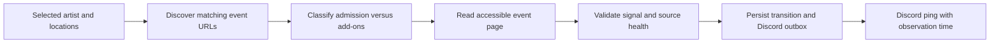

# Website monitoring: design and KoRn feasibility check

Date: 2026-11-09. Status: one successful live KoRn offer capture plus the website adapter design. The first implementation is available (see [running the monitor](running.md)); unattended access and alerts remain unverified, and no live monitoring service has been deployed.

Later update: [Czech access diagnosis and price snapshot](czech-access.md) records
successful headed Chromium access to the Prague event and the correction for its
initial identification-page navigation. The observations below describe the
earlier feasibility checks.

Decision: this is the primary acquisition design. The user reports that the demonstrated service scrapes websites. Begin with KoRn Poland; implement additional markets after validating their page signals and access behavior. Website fetching does not require a Ticketmaster API key. The newly available Explorer key is used separately for Discovery artist/event searches. The reference service's exact requests, session handling, and polling frequency are not yet known.

## Conclusion

Ordinary graphical Chromium navigation from the Polish KoRn artist page to its event and then “best available” exposed four primary ticket types and two resale listings. The [capture report](korn-capture.md) records the displayed prices, listing quantities, screenshots, and selectors. Earlier direct Chromium checks returned HTTP 403. The successful snapshot establishes readable offers in that session; it does not establish a sustainable request rate, unattended access, or worldwide restock coverage.

The user later supplied screenshots of another service's detailed Discord alerts and a browser checkout for the same KoRn Krakow event. These clarify the [desired alert fields](alert-reference.md) and show a different session reaching checkout; our 403 results do not imply that monitoring is universally impossible. The screenshots do not establish that service's acquisition method or detection latency.

## Observations

| Page | Evidence obtained | Interpretation |
| --- | --- | --- |
| [KoRn artist listing](https://www.ticketmaster.co.uk/korn-tickets/artist/775700) | Web research returned event dates, venues, country-specific links, and some limited-availability labels. | Useful discovery evidence. Research-tool retrieval is not proof a deployed scraper can fetch it, or that labels update immediately. |
| [Prague, O2 arena, 16 November 2026](https://www.ticketmaster.cz/event/korn-vstupenky/1472650657) | Web extraction returned event metadata and ticket-selection interface text. Direct Chromium navigation returned 403 with no body text. | Inventory is unknown; direct browser access was blocked in this session. |
| [Krakow, TAURON Arena, 17 November 2026](https://www.ticketmaster.pl/event/korn-bilety/496543017) | Graphical artist → event → best-available navigation displayed primary types/prices and resale C9/27 (2 at 575 PLN) and A9/6 (2 at 910.80 PLN). Earlier direct navigation returned 403. | Positive listing evidence for one snapshot. Quantities belong to each listing, not total event stock. Automated access remains unverified. |

The artist listing also includes parking, fast-track products, premium packages, and external ticket sellers. Artist-name matching alone would produce unwanted alerts. Separate ordinary admission from add-ons and packages, and make festival/premium inclusion configurable. Do not infer missing events or sold-out status from one regional listing.

The earlier direct browser checks used installed Chromium through Playwright and inherited network proxy settings. The successful graphical capture followed visible artist/event links and opened the best-available and information panels. No ticket search submission, cart, purchase, credential entry, CAPTCHA solving, or access-control workaround was attempted. The earlier responses do not establish which upstream layer issued the 403.

A direct request through the implemented Rust HTTP fetcher returned HTTP 401 for the Krakow page, with `server=envoy` and `content-type=application/json`. The program recorded `blocked`, no offers, and unknown inventory. The response does not identify the layer requiring authentication and does not establish that a Discovery key would unlock the website.

The automated browser worker remains headless and navigates directly to an event; it does not follow the successful artist-page route or open “best available.” No runtime code was changed for this capture. Raw captures remain ignored/private; the report links to the shareable screenshots and normalized observations.

## Proposed process

1. **Discover:** read selected artist listings at a modest source-appropriate cadence, resolve canonical event links, apply location filters, and exclude unrelated products. Manual event URLs are a fallback when discovery access is unavailable. Store website event IDs separately from API universal IDs.
2. **Fetch:** prefer ordinary HTTP and parse HTML/embedded page data when it contains the needed information. Use a persistent Chromium worker only when the visible signal requires JavaScript. Rust retains scheduling, state, storage, and Discord delivery. Each country/layout gets an independently validated adapter.
3. **Classify:** record observed availability separately from signal strength, health, source timestamp when present, receipt time, and parser version. A generic purchase link, price range, or scheduled opening does not prove inventory.
4. **Notify:** use the shared durable outbox. A validated available transition produces a timestamped Discord alert. Coarse website labels are explicitly described as page-reported availability, without claims about specific seats or quantities.

## Signal rules

| Page evidence | Result |
| --- | --- |
| Explicit ticket listings or a validated event-specific availability indicator | Positive observation, qualified by what the page actually establishes. |
| Coarse limited-availability label on an artist listing | Page-status signal only; upstream age and purchasable quantity are unknown. |
| Explicit unavailable message for the relevant sale/inventory type | Negative observation for that scope only. |
| Generic “Find tickets,” empty seat map, price metadata, or sale date | Insufficient inventory evidence. |
| 403, CAPTCHA, waiting room, timeout, missing selector, incomplete render, or expired session | Unknown/blocked; preserve last valid state and report monitoring health. |

Do not create a restock transition when a blocked page starts loading again. Retain the last valid inventory state and use the recovery semantics in the main architecture. Separate primary, resale, and restricted offers when the page identifies them; otherwise report the limitation.

## Speed and operating constraints

Reuse clients and browser contexts, share event checks across subscriptions, bound concurrency, and avoid rendering or downloading unrelated assets where that does not break the page. Browser requests cannot use Inventory Status's multi-event batching. Subresource requests also contribute load; count more than top-level navigations when estimating capacity.

No interval is selected yet. Establish applicable site rules, permitted access, stable signals, and observed behavior before enabling repeated monitoring. Respect retry instructions and stop/back off on access failures. There is no assumption that rotating identities, replaying protected credentials, or defeating challenges is necessary to make this design work.

Ticketmaster's [current error guidance](https://help.ticketmaster.com/hc/en-us/articles/9760115676433-Why-did-I-receive-an-error-message) documents pauses from repeated refreshing and automated tools. The current US terms page did not expose its full text through the research tool; a prior-version document was found, so this review makes no assertion that old numerical request limits are current permission. Confirm terms for the actual market.

The meaningful latency includes page publication/cache delay, sampling delay, rendering, processing, and Discord delivery. Rust cannot eliminate the first three. Until an accessible page and representative transitions have been validated, no sub-second or other live detection promise is justified.

## Next validation milestone

Use the captured KoRn markup to validate field extraction, including labeled listing quantities and price ranges. Then compare automated observations with the rendered page across available, unavailable, and blocked cases. Save minimal sanitized fixtures and test parsers offline. Verify that parking/fast-track listings do not trigger admission alerts. Measure access success and source freshness over a permitted trial before turning on Discord pings.

The KoRn capture establishes readable offers through ordinary browser navigation. A continuously working scraper and end-to-end Discord alerts still need to be demonstrated.
